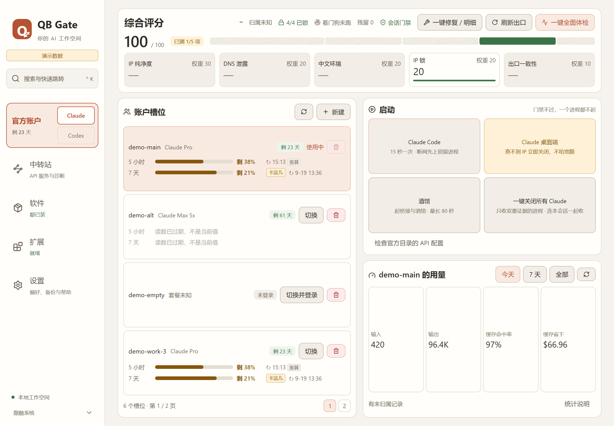
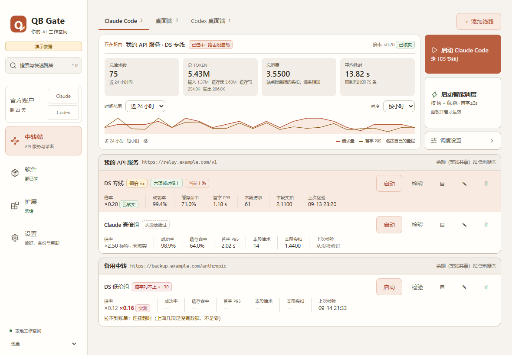
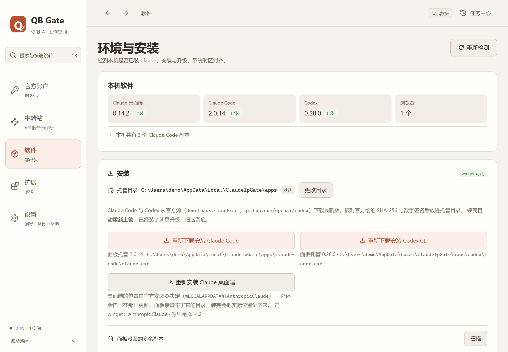
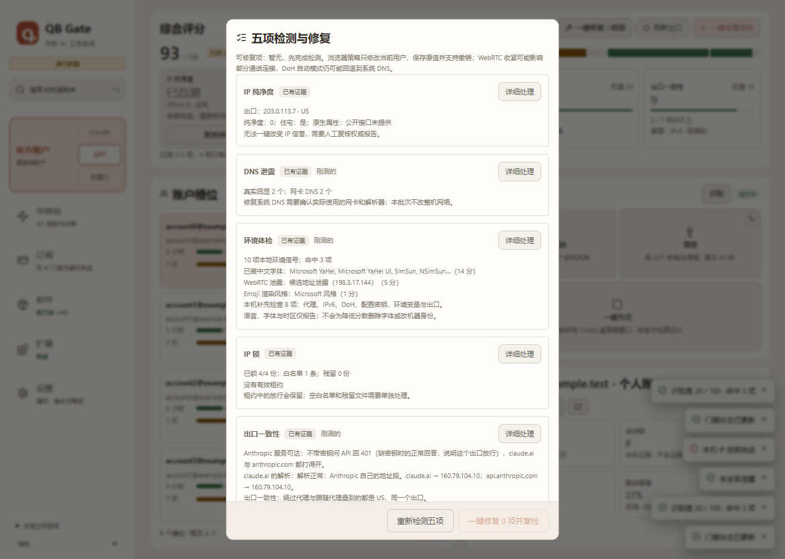

# QB Gate

[简体中文](README.md) | **English**

**A local AI workspace for Windows and Mac.**

Manage Claude, GPT (Codex) and Antigravity accounts, connect API routes, install CLI tools, and inspect usage and network conditions in one desktop app. The IP gate checks your network exit before managed launches and monitors it while apps run.

## Download

| Platform | Requirements                             | Installer                                                                                                                                                                                                                                       |
| -------- | ---------------------------------------- | ----------------------------------------------------------------------------------------------------------------------------------------------------------------------------------------------------------------------------------------------- |
| Windows  | Windows 10 / 11, x64                     | [Download EXE](https://github.com/smithtaylor7748-ops/qb-gate/releases/latest/download/QB-Gate-Windows-x64-setup.exe) · [Stable release](https://github.com/smithtaylor7748-ops/qb-gate/releases/latest)                                        |
| macOS    | Apple Silicon (M1 or newer), macOS 13.3+ | [Download DMG](https://github.com/smithtaylor7748-ops/qb-gate/releases/download/macos-v0.25.14-preview.1/QB-Gate-macOS-arm64.dmg) · [Mac preview release](https://github.com/smithtaylor7748-ops/qb-gate/releases/tag/macos-v0.25.14-preview.1) |

On Windows, run the installer and check for future updates in Settings. On Mac, open the DMG and drag the app into Applications; see the [Mac installation guide](docs/MACOS.zh-CN.md) for first launch, permissions and updates. The app interface is currently in Simplified Chinese.

## Features

| Feature                     | What you can do                                                                                                                                                                                                                         |
| --------------------------- | --------------------------------------------------------------------------------------------------------------------------------------------------------------------------------------------------------------------------------------- |
| **Official accounts**       | Manage account slots for Claude, Codex and Antigravity IDE, switch accounts manually, open official clients to sign in, and view credential status, quotas and usage.                                                                   |
| **IP gate**                 | Configure IP and country allowlists, check before launch, monitor running apps, inspect logs, verify and reopen the gate, or pause it and close managed sessions. Set the polling interval from 1–30 seconds; the default is 5 seconds. |
| **Network diagnostics**     | Inspect IP quality, DNS resolution, proxies and routes, IPv6, browser environment signals and exit consistency, with detailed results and actions.                                                                                      |
| **API routes**              | Manage providers, API keys, models and routes. Use a selected route or configure fallback and scheduling within a route pool, then inspect request history, latency and costs.                                                          |
| **Software management**     | Discover, install and update CLIs such as Claude Code, Codex CLI and Gemini CLI, track versions and installation progress, and roll back managed Claude Code versions.                                                                  |
| **Extensions and projects** | Manage MCP, Skills, prompts and project configuration, connect SillyTavern bridges, and preview configuration changes before applying them.                                                                                             |
| **Usage and pricing**       | Explore usage by date, model and account, estimate equivalent official API costs, and compare subscription plans and API route prices.                                                                                                  |

On Windows, the IP gate combines system execution locks with a watchdog. On Mac, it checks launches made through QB Gate and supervises running apps with a watchdog. Software installation and system settings adapt to each platform.

## Get started

1. **Prepare your tools.** Open Software to discover existing installations or install CLI tools. Links to official desktop app downloads are available on the same page.
2. **Check your network.** Run diagnostics from Official Accounts, open IP Lock, and check and add an approved exit IP.
3. **Sign in and launch.** Create an account slot and open its official client to sign in. Use the panel to launch, switch accounts and view quotas.
4. **Connect an API service.** Add the service URL and key under API Routes, choose a model and route, then start the client. Configure a route pool and scheduling rules when you want multiple fallback routes.

The usage page shows today, the last 7 days and the last 30 days. Dollar values use official API prices to help compare usage.

## Screenshots

Screenshots use demo data.

| Official accounts                                                                  | API routes                                                                   |
| ---------------------------------------------------------------------------------- | ---------------------------------------------------------------------------- |
|  |  |
| **Accounts and launch**: login slots, quotas, usage and network status             | **Routes and models**: providers, model selection and scheduling             |

| Software management                                                            | Network diagnostics                                                                    |
| ------------------------------------------------------------------------------ | -------------------------------------------------------------------------------------- |
|  |  |
| **Tools and versions**: discovery, upgrades and rollback                       | **Checks and actions**: inspect and address individual results                         |

## Documentation and community

- [Mac installation and builds](docs/MACOS.zh-CN.md) · [Windows installation help](docs/ANTIVIRUS.zh-CN.md) · [Releases](https://github.com/smithtaylor7748-ops/qb-gate/releases)
- [Contributing](CONTRIBUTING.md) · [Architecture](docs/ARCHITECTURE.zh-CN.md) · [Report an issue](https://github.com/smithtaylor7748-ops/qb-gate/issues)
- QQ group: `1109462206` · [LINUX DO community](https://linux.do/)

Installation guides and community discussions are primarily in Chinese.

## License

**AGPL-3.0-only**, with [section 7 additional terms](LICENSE-ADDITIONAL-TERMS.md) covering attribution, identification of modified versions and a separate name for modified distributions. See [LICENSE](LICENSE) for the full license and [commercial licensing](LICENSE-COMMERCIAL.md) for an alternative.

> Based on QB Gate, Copyright (C) 2026 smithtaylor7748-ops.
> Source code: https://github.com/smithtaylor7748-ops/qb-gate

### License notice

<details>
<summary>GNU AGPL v3 and additional terms notice</summary>

```text
QB Gate — A local AI client workspace
Copyright (C) 2026 smithtaylor7748-ops

This program is free software: you can redistribute it and/or modify
it under the terms of the GNU Affero General Public License as published
by the Free Software Foundation, version 3, supplemented by the additional
terms permitted under section 7 of that license and set out in
LICENSE-ADDITIONAL-TERMS.md (preservation of attribution, marking of
modified versions, and no grant of the "QB Gate" name).

This program is distributed in the hope that it will be useful,
but WITHOUT ANY WARRANTY; without even the implied warranty of
MERCHANTABILITY or FITNESS FOR A PARTICULAR PURPOSE. See the
GNU Affero General Public License for more details.

You should have received a copy of the GNU Affero General Public License
along with this program. If not, see <https://www.gnu.org/licenses/>.
```

</details>

[Third-party notices](THIRD_PARTY_NOTICES.txt) · [Usage terms](DISCLAIMER.md)
