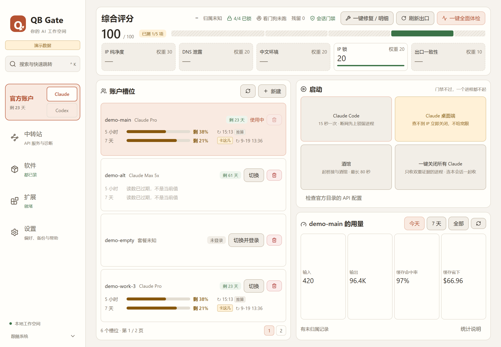
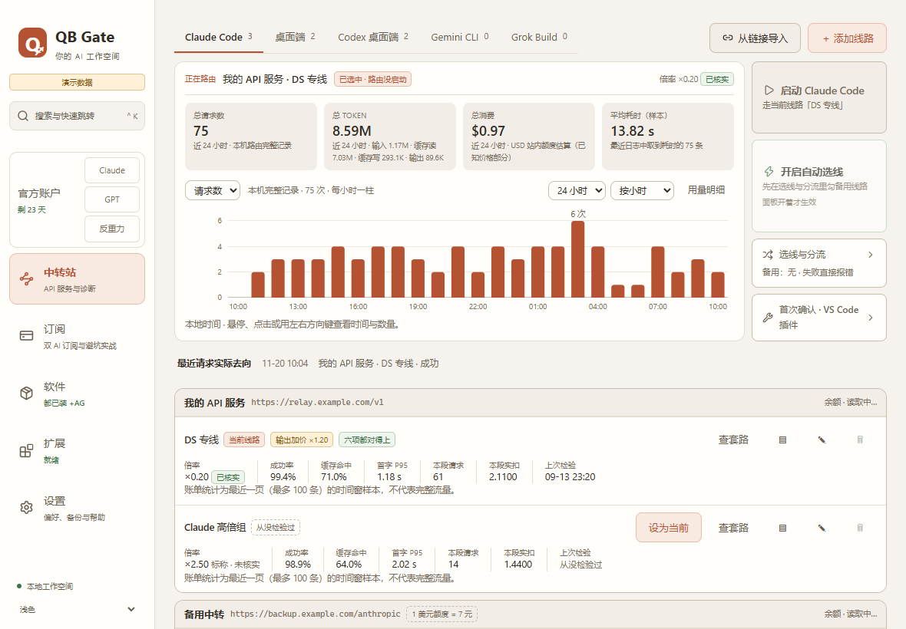
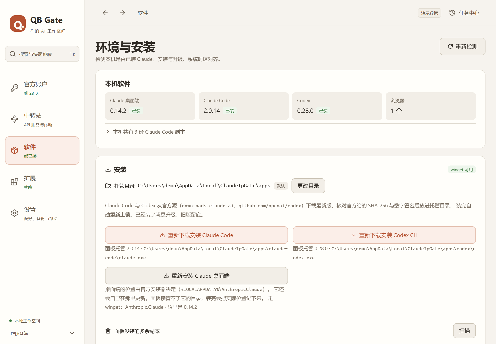
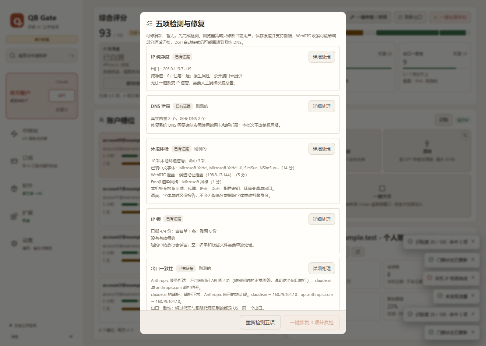

# QB Gate

[简体中文](README.md) | **English**

**One panel for the AI tools on your Windows or Mac machine.**

Official Claude, Codex and Antigravity accounts, your own API relay routes, the command-line tools installed on your computer, and your browser and network environment — all in one place. Official accounts sit behind the IP gate: if your network exit looks wrong, they don't run. Relay routes use your own API keys and are not bound by the gate.

## Download

| Platform | Requirements                             | Download                                                                                                                                                                                                                                       |
| -------- | ---------------------------------------- | ---------------------------------------------------------------------------------------------------------------------------------------------------------------------------------------------------------------------------------------------- |
| Windows  | Windows 10 / 11, x64                     | [Download EXE](https://github.com/smithtaylor7748-ops/qb-gate/releases/latest/download/QB-Gate-Windows-x64-setup.exe) · [Release page](https://github.com/smithtaylor7748-ops/qb-gate/releases/latest)                                         |
| macOS    | Apple Silicon (M1 or newer), macOS 13.3+ | [Download DMG](https://github.com/smithtaylor7748-ops/qb-gate/releases/download/macos-v0.25.14-preview.1/QB-Gate-macOS-arm64.dmg) · [Mac preview release](https://github.com/smithtaylor7748-ops/qb-gate/releases/tag/macos-v0.25.14-preview.1) |

- **Windows**: run the installer. When a new version is out, the panel tells you on launch and updates with one click.
- **The browser helper (a Chrome extension) is installed together with the Windows app** — no separate download. In the panel, go to "扩展 → 浏览器助手" (Extensions → Browser helper) and click "打开插件文件夹" (open extension folder). The release page also carries a standalone zip of the extension.
- **Mac**: open the DMG and drag the app into Applications. See the [Mac installation guide](docs/MACOS.zh-CN.md) for first launch and permissions. The Mac preview is still 0.25.14-preview.1 and does not have the changes below yet.

The app interface is in Simplified Chinese.

## What's new in 0.25.16

**The browser helper was rebuilt — you can now find it and it works.**

- It ships with the installer and has its own entry on the Extensions page. Three steps: open the extension folder → load it in Chrome → click "连接浏览器" (connect browser).
- Pair once and you're done: no pairing code to copy. It reconnects by itself after the panel restarts, the port changes, or the browser restarts.
- Protection blocks only protected sites: once on, claude.ai and the like open only after QB Gate confirms your exit IP is fine. If the exit changes, can't be verified, or the panel quits, those sites are blocked with the reason shown. Other sites and tabs are never touched.

**The relay page was cleaned up, with the same layout.**

- Route selection comes down to three ideas: **current route** (changes only when you click "设为当前", set as current), **backup routes** (you pick and order them; used only when the current route fails), and **auto-select** (chooses only among those, cheapest first by default).
- Clicking a row no longer switches routes, and removing a route or changing the listen scope asks first.
- The chart switches between requests, tokens and cost. When the current route is paused, the page says why and which backup is in use.
- A request tries at most 2 routes by default, so a failure costs less across stations.

## What it does

### Official accounts and the IP gate

- Manage account slots for Claude, Codex and Antigravity, switch accounts by hand, sign in through the official clients, and view quotas and usage.
- Set IP and country allowlists for official accounts: checked before launch and every 1–30 seconds while running (5 by default); managed sessions close when the exit isn't allowed or can't be verified.
- "Close all Claude" errs on the side of closing too much: the MCP servers, terminals and tools Claude started go down with it.

### Relay routes

- Manage stations, API keys, models and routes; presets for common official services; add routes from a CC Switch import link.
- Current route + backup routes + auto-select; the local router sends each request to the right route and converts between Claude, OpenAI and Gemini protocols when needed.
- Request logs, usage details and station balances; the plan checker compares what a station actually charged against real bills.

### Browser helper (Chrome extension)

- With protection on, protected sites (by default claude.ai, claude.com, anthropic.com, claudeusercontent.com and their subdomains; editable in the extension) open only after the exit IP checks out.
- After a browser restart or an extension background restart, those sites stay blocked until the check passes — no gap.
- Extras: check the current browser's language, time zone, WebRTC and more; reuse New API / Sub2API accounts already signed in to Chrome in the plan checker; read the public model prices a station publishes.

### Network diagnostics

- IP quality, DNS leaks, proxies and routes, IPv6, browser and Chinese-locale environment, exit consistency.
- On demand: compare UDP / HTTP exits, proxy runtime rules and ASN network types.

### Software, extensions and usage

- Discover, install, update and roll back Claude Code, Codex CLI, Gemini CLI and other command-line tools; host SillyTavern.
- Manage MCP, Skills, prompts and "projects" (switch a whole set of MCP / Skills / prompts at once); browse local Claude Code / Codex sessions.
- Usage by date, model and account, priced at official API rates, and a comparison of subscription plans and relay prices.

## Get started in five minutes

1. **Install tools**: open Software to detect existing installations or install the command-line tools you need.
2. **Set up the gate**: run the environment check on the official accounts page, open "IP 锁" (IP lock) and add the exit IPs you trust.
3. **Sign in**: create an account slot, sign in through its official client, then launch and switch from the panel.
4. **Connect a relay (optional)**: add a station URL and key under Relays, pick a route with "设为当前", then start the client. For fallback, tick a few backup routes under "选线与分流" (route selection).
5. **Install the browser helper (optional)**: Extensions → 浏览器助手 → "打开插件文件夹"; in Chrome open `chrome://extensions`, turn on Developer mode, choose "Load unpacked" and pick that folder; back in the panel click "连接浏览器", then click "开启保护" (turn on protection) in the extension.

## Usage boundaries (please read)

- **Account switching is always manual.** The panel never reads rate-limit state to switch accounts, never rotates accounts based on quota or errors, and keeps only one account active at a time.
- **Every account must be your own.**
- **The IP gate guards against your exit changing while apps run, not against you.** Emergency unlock or deliberately running the dedicated relay copy of Claude Code bypasses it.
- **The browser helper covers only the Chrome profile it's installed in.** It blocks after it detects a problem; it is not a firewall and reacts within seconds. Other browsers and profiles are not protected.
- **"Close all Claude" also ends the processes Claude started** (for example a dev server it launched for you); unsaved work in them is lost.

## Screenshots

Screenshots use demo data.

| Official accounts                                                                  | Relays                                                                               |
| ---------------------------------------------------------------------------------- | ------------------------------------------------------------------------------------ |
|  |  |
| **Accounts and launch**: login slots, quotas, usage and network status             | **Current and backup routes**: usage chart, route selection and stations             |

| Software management                                                            | Network diagnostics                                                                    |
| ------------------------------------------------------------------------------ | -------------------------------------------------------------------------------------- |
|  |  |
| **Tools and versions**: discovery, upgrades and rollback                       | **Checks and actions**: inspect and address individual results                         |

## Documentation and community

- [Mac installation and builds](docs/MACOS.zh-CN.md) · [Windows installation help (antivirus false positives)](docs/ANTIVIRUS.zh-CN.md) · [Known limitations](docs/KNOWN-ISSUES.zh-CN.md) · [Browser helper](browser-extension/README.md) · [Releases](https://github.com/smithtaylor7748-ops/qb-gate/releases)
- [Contributing](CONTRIBUTING.md) · [Architecture](docs/ARCHITECTURE.zh-CN.md) · [Report an issue](https://github.com/smithtaylor7748-ops/qb-gate/issues)
- QQ group: `1109462206` · [LINUX DO community](https://linux.do/)

Installation guides and community discussions are primarily in Chinese.

## License

**AGPL-3.0-only**, with [section 7 additional terms](LICENSE-ADDITIONAL-TERMS.md) covering attribution, identification of modified versions and a separate name for modified distributions. See [LICENSE](LICENSE) for the full license and [commercial licensing](LICENSE-COMMERCIAL.md) for an alternative.

> Based on QB Gate, Copyright (C) 2026 smithtaylor7748-ops.
> Source code: https://github.com/smithtaylor7748-ops/qb-gate

### License notice

<details>
<summary>GNU AGPL v3 and additional terms notice</summary>

```text
QB Gate — A local AI client workspace
Copyright (C) 2026 smithtaylor7748-ops

This program is free software: you can redistribute it and/or modify
it under the terms of the GNU Affero General Public License as published
by the Free Software Foundation, version 3, supplemented by the additional
terms permitted under section 7 of that license and set out in
LICENSE-ADDITIONAL-TERMS.md (preservation of attribution, marking of
modified versions, and no grant of the "QB Gate" name).

This program is distributed in the hope that it will be useful,
but WITHOUT ANY WARRANTY; without even the implied warranty of
MERCHANTABILITY or FITNESS FOR A PARTICULAR PURPOSE. See the
GNU Affero General Public License for more details.

You should have received a copy of the GNU Affero General Public License
along with this program. If not, see <https://www.gnu.org/licenses/>.
```

</details>

[Third-party notices](THIRD_PARTY_NOTICES.txt) · [Usage terms](DISCLAIMER.md)
