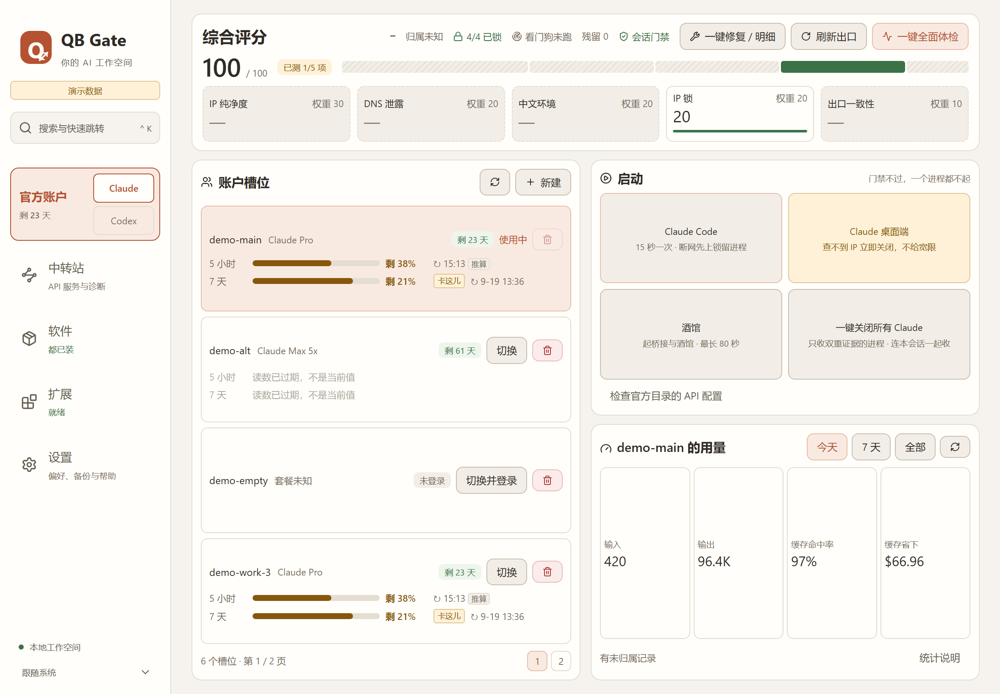
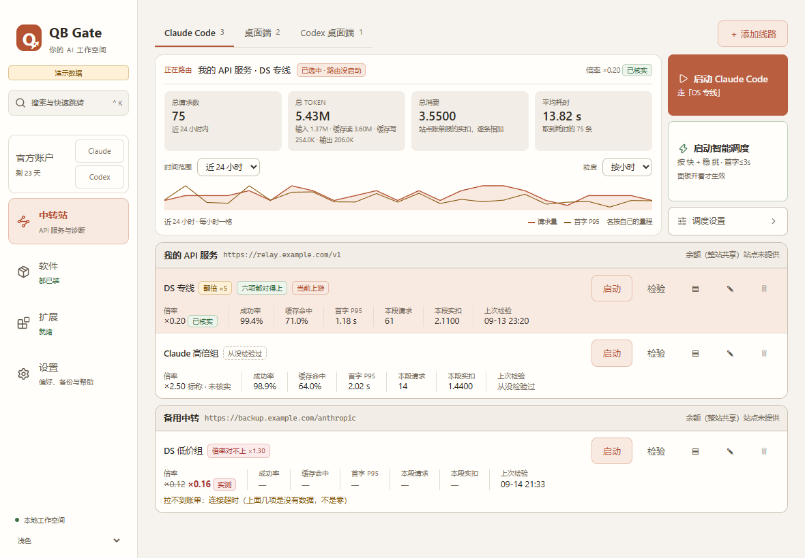
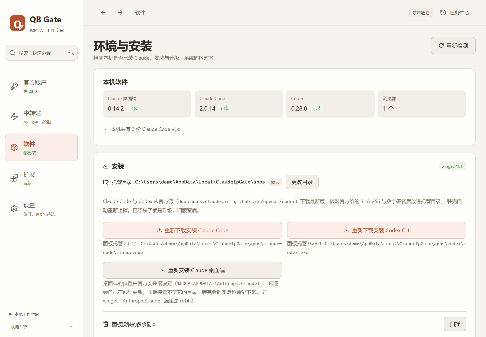
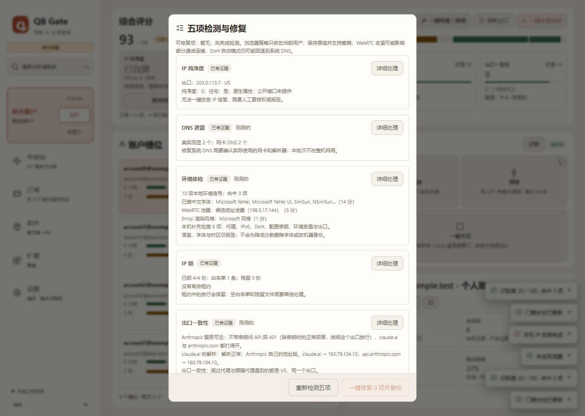

# QB Gate

**简体中文** | [English](README.en.md)

**Windows 与 Mac 上的本地 AI 工作空间。**

在一个面板里管理 Claude、GPT（Codex）和反重力的官方账户，接入中转线路，安装命令行工具，查看用量与网络环境。官方账户由 IP 门禁把关：启动前检查出口，运行期间持续巡检；中转线路用你自己的 API Key，不受门禁约束。

标 🆕 的是 0.25.15 新增或改变的内容。

## 下载

| 平台    | 系统要求                                    | 安装包                                                                                                                                                                                                                                   |
| ------- | ------------------------------------------- | ---------------------------------------------------------------------------------------------------------------------------------------------------------------------------------------------------------------------------------------- |
| Windows | Windows 10 / 11，x64                        | [下载 EXE](https://github.com/smithtaylor7748-ops/qb-gate/releases/latest/download/QB-Gate-Windows-x64-setup.exe) · [稳定版发布页](https://github.com/smithtaylor7748-ops/qb-gate/releases/latest)                                       |
| macOS   | Apple Silicon（M1 及更新芯片），macOS 13.3+ | [下载 DMG](https://github.com/smithtaylor7748-ops/qb-gate/releases/download/macos-v0.25.14-preview.1/QB-Gate-macOS-arm64.dmg) · [Mac 预览版发布页](https://github.com/smithtaylor7748-ops/qb-gate/releases/tag/macos-v0.25.14-preview.1) |

Windows 运行安装包即可安装，之后在「设置」中检查更新，已装旧版的会在打开面板时收到更新提醒。Mac 打开 DMG，将应用拖入 Applications；首次打开、系统授权与更新步骤见 [Mac 安装说明](docs/MACOS.zh-CN.md)。

## 主要功能

| 功能                     | 可以做什么                                                                                                                                                                                   |
| ------------------------ | -------------------------------------------------------------------------------------------------------------------------------------------------------------------------------------------- |
| **官方账户**             | 管理 Claude、Codex 和反重力 IDE 的账户槽位，手动切换账户，打开官方客户端登录，查看凭据状态、额度和用量。                                                                                     |
| **IP 门禁**              | 为官方账户设置出口 IP 与国家白名单：启动前检查，运行期间按 1–30 秒（默认 5 秒）巡检，出口不在白名单或查不到时关闭受管会话；可查看日志、重新验证放行，或暂停门禁。                            |
| **一键关闭** 🆕          | 「一键关闭所有 Claude」改为宁可错杀、不可放过：名字是 claude.exe 的进程、Claude 拉起的 MCP 服务器、命令行和工具一起关闭；已经在退出的进程不再报错。GPT、Gemini、反重力与共用的酒馆照常运行。 |
| **中转站**               | 管理 API 站点、密钥、模型和线路；使用指定线路，或在线路池内配置备用与调度，查看请求记录、延迟和费用。🆕 中转不再受 IP 门禁约束：不开代理也能启动，出口变化不会关掉中转会话。                 |
| **Chrome 浏览器助手** 🆕 | 插件与面板配对后，可为当前 Chrome 资料单独开启 IP 保护，并把浏览器检测结果交给面板；查套路可复用 Chrome 中已登录的 New API / Sub2API 账户，读取站点公开的模型价格。                          |
| **环境检测**             | 检查 IP 纯净度、DNS 解析、代理与路由、IPv6、浏览器环境和出口一致性；按需对照 UDP / HTTP 出口、代理运行规则与 ASN 网络类型。                                                                  |
| **软件管理**             | 检测、安装和升级 Claude Code、Codex CLI、Gemini CLI 等命令行工具，集中查看版本与安装进度，回滚托管的 Claude Code 历史版本。                                                                  |
| **扩展与项目**           | 管理 MCP、Skills、提示词与项目配置，连接 SillyTavern 桥接，导入配置并预览变更。                                                                                                              |
| **用量与价格**           | 按日期、模型和账户查看用量，按官方 API 价格折算费用，比较订阅方案与中转价格。                                                                                                                |

Windows 的 IP 门禁结合系统执行锁与看门狗；Mac 在从 QB Gate 启动时检查 IP，并由看门狗监督运行。软件安装和系统设置入口随平台显示。

## 开始使用

1. **准备工具**：在「软件」页检测已有安装，或安装需要的命令行工具；桌面客户端可从同一页的官方入口获取。
2. **检查网络**：在官方账户页运行环境检测，打开「IP 锁」，检测并加入认可的出口 IP。
3. **登录并启动**：新建账户槽位，打开对应的官方客户端完成登录，再从面板启动、切换和查看额度。
4. **连接中转**：在「中转站」添加服务地址与密钥，选择模型和线路，再启动对应客户端。需要多条备用线路时设置线路池与调度规则。🆕 中转启动不经过 IP 门禁。
5. 🆕 **连接 Chrome（可选）**：下载发布页的源码压缩包，在 Chrome 打开 `chrome://extensions`、开启开发者模式，「加载已解压的扩展程序」选其中的 `browser-extension` 文件夹；再到面板「环境体检」里的「Chrome 插件联动」生成配对码并粘贴到插件。

用量页提供今天、近 7 天和近 30 天的明细；美元数值按官方 API 价格折算，用于比较使用量。

## 使用边界

- **账户切换只由你手动触发**：面板不读取限流状态来换号，不按额度或报错自动轮换账户，同一时间只有一个账户处于激活状态。
- **所有账户必须是你本人拥有的。**
- **IP 门禁防的是运行中出口悄悄变化，不防本机使用者自己**：应急解锁、刻意运行中转专用的 Claude Code 副本都能绕开它。
- 🆕 **一键关闭会结束 Claude 拉起的子进程**（例如它替你启动的开发服务器），未保存的内容会丢失。

## 界面预览

以下截图使用演示数据。

| 官方账户                                                   | 中转站                                                         |
| ---------------------------------------------------------- | -------------------------------------------------------------- |
|  |  |
| **账户与启动**：登录槽位、额度、用量和网络状态             | **线路与模型**：站点管理、模型选择和调度                       |

| 软件管理                                             | 环境检测                                                         |
| ---------------------------------------------------- | ---------------------------------------------------------------- |
|  |  |
| **安装与版本**：工具检测、升级和回滚                 | **检测与处理**：查看明细，按项处理                               |

## 文档与社区

- [Mac 安装与构建](docs/MACOS.zh-CN.md) · [Windows 安装帮助](docs/ANTIVIRUS.zh-CN.md) · [已知限制](docs/KNOWN-ISSUES.zh-CN.md) · [版本记录](https://github.com/smithtaylor7748-ops/qb-gate/releases)
- [贡献指南](CONTRIBUTING.md) · [架构说明](docs/ARCHITECTURE.zh-CN.md) · [问题反馈](https://github.com/smithtaylor7748-ops/qb-gate/issues)
- QQ 群「门禁值班室」：`1109462206` · [LINUX DO 社区](https://linux.do/)

## 许可证

**AGPL-3.0-only**，附 [第 7 节补充条款](LICENSE-ADDITIONAL-TERMS.md)：保留署名与仓库链接，标明修改版，修改版使用独立名称。完整许可见 [LICENSE](LICENSE)，另提供 [商业授权](LICENSE-COMMERCIAL.md)。

> 基于 QB Gate，版权所有 (C) 2026 smithtaylor7748-ops。
> 源码：https://github.com/smithtaylor7748-ops/qb-gate

### 授权声明

<details>
<summary>GNU AGPL v3 与附加条款声明</summary>

```text
QB Gate — 本地 AI 客户端工作空间
Copyright (C) 2026 smithtaylor7748-ops

This program is free software: you can redistribute it and/or modify
it under the terms of the GNU Affero General Public License as published
by the Free Software Foundation, version 3, supplemented by the additional
terms permitted under section 7 of that license and set out in
LICENSE-ADDITIONAL-TERMS.md (preservation of attribution, marking of
modified versions, and no grant of the "QB Gate" name).

This program is distributed in the hope that it will be useful,
but WITHOUT ANY WARRANTY; without even the implied warranty of
MERCHANTABILITY or FITNESS FOR A PARTICULAR PURPOSE. See the
GNU Affero General Public License for more details.

You should have received a copy of the GNU Affero General Public License
along with this program. If not, see <https://www.gnu.org/licenses/>.
```

</details>

[第三方声明](THIRD_PARTY_NOTICES.txt) · [使用说明与声明](DISCLAIMER.md)
