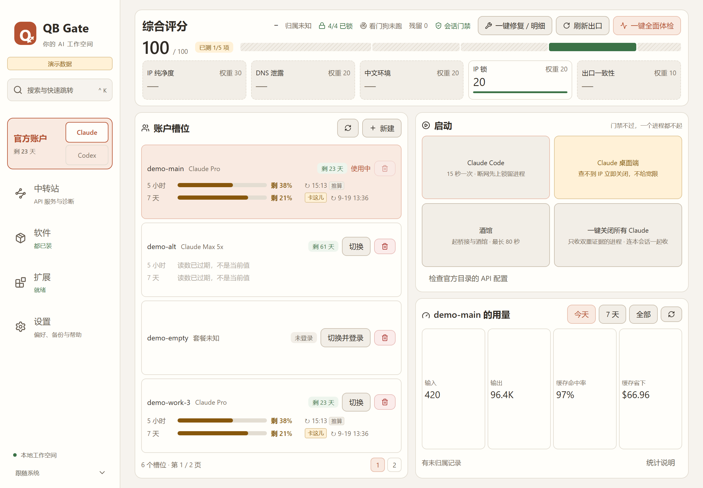
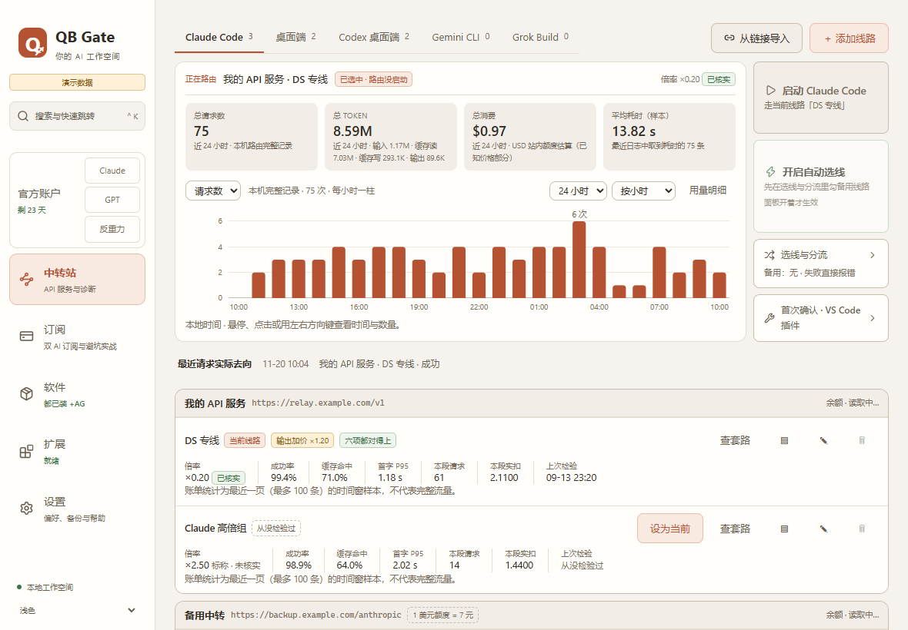
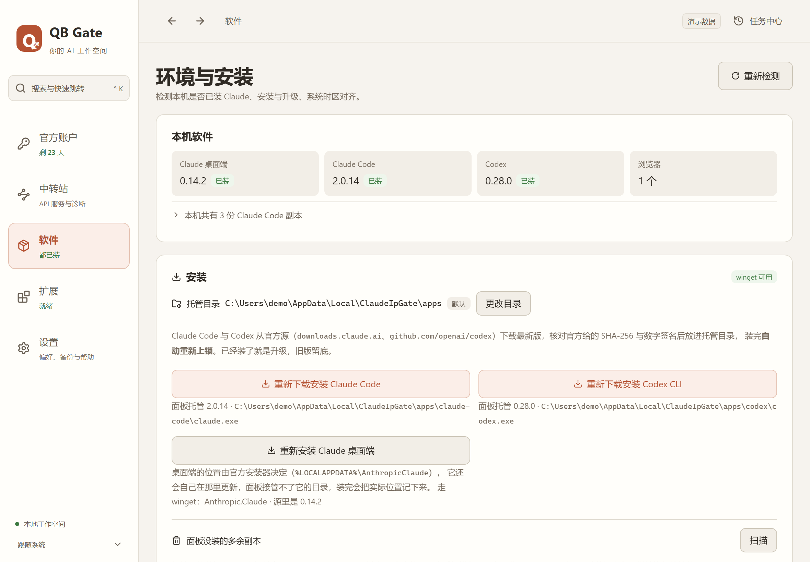
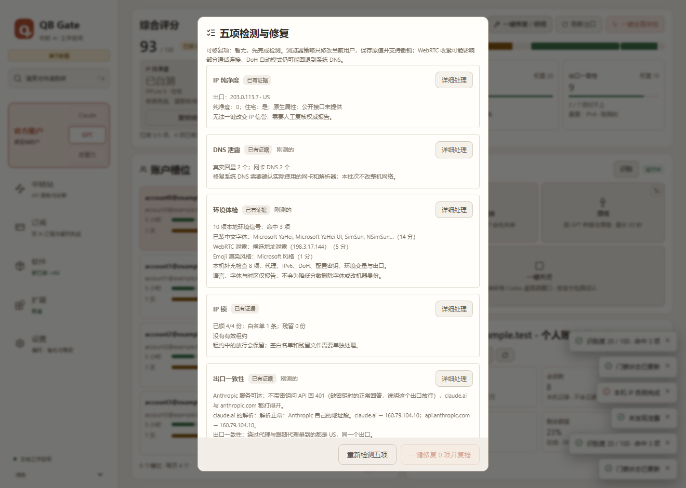

# QB Gate

**简体中文** | [English](README.en.md)

**一个面板，管住你在 Windows 和 Mac 上的 AI 工具。**

Claude、Codex、反重力的官方账户，你自己的中转线路，装在电脑上的命令行工具，还有浏览器和网络环境 —— 都在同一个地方看、同一个地方管。官方账户由 IP 门禁守着：出口不对就不让用；中转线路用你自己的 API Key，不受门禁限制。

## 下载

| 平台    | 系统要求                                    | 下载                                                                                                                                                                                                                                     |
| ------- | ------------------------------------------- | ---------------------------------------------------------------------------------------------------------------------------------------------------------------------------------------------------------------------------------------- |
| Windows | Windows 10 / 11，x64                        | [下载 EXE](https://github.com/smithtaylor7748-ops/qb-gate/releases/latest/download/QB-Gate-Windows-x64-setup.exe) · [发布页](https://github.com/smithtaylor7748-ops/qb-gate/releases/latest)                                             |
| macOS   | Apple Silicon（M1 及更新芯片），macOS 13.3+ | [下载 DMG](https://github.com/smithtaylor7748-ops/qb-gate/releases/download/macos-v0.25.14-preview.1/QB-Gate-macOS-arm64.dmg) · [Mac 预览版发布页](https://github.com/smithtaylor7748-ops/qb-gate/releases/tag/macos-v0.25.14-preview.1) |

- **Windows**：运行安装包即可。以后打开面板会自动提示新版本，点一下就能更新。
- **浏览器助手（Chrome 插件）随 Windows 安装包一起装好**，不用另外下载；在面板「扩展 → 浏览器助手」里点「打开插件文件夹」就能找到。发布页另附一份单独的插件压缩包。
- **Mac**：打开 DMG，把应用拖进「应用程序」。首次打开与系统授权见 [Mac 安装说明](docs/MACOS.zh-CN.md)。Mac 预览版目前停在 0.25.14-preview.1，下面「这一版的变化」还没有同步过去。

## 这一版的变化（0.25.16）

**浏览器助手重做了，现在找得到、用得上。**

- 插件跟着安装包走，面板「扩展」页有它自己的入口，三步装好：打开插件文件夹 → 在 Chrome 加载 → 点「连接浏览器」。
- 配对一次长期有效：不用复制粘贴配对码，面板重启、换端口、浏览器重启之后都会自己连回来。
- 保护只拦受保护的网站：开启保护后，claude.ai 等网站要等 QB Gate 确认出口 IP 没问题才放行；出口变了、查不到、面板退出，就拦住并写清原因。别的网站、别的标签页一律不碰。

**中转站页面理顺了，版面没变。**

- 选线只剩三个概念：**当前线路**（点「设为当前」才会换）、**备用线路**（你勾、你排顺序，只在当前线路出故障时用）、**自动选线**（只在这两者里挑，默认省钱优先）。
- 不会再「点一下整行就切线」；移除线路、改监听范围这类动作都先确认。
- 柱状图能切换看请求数、Token 或花费；当前线路被暂停时，页面会直接告诉你原因、改用了哪条备用线路。
- 一次请求默认最多试 2 条线路，减少失败重试时在多个站点上重复计费。

## 能做什么

### 官方账户与 IP 门禁

- 管理 Claude、Codex、反重力的账户槽位，手动切换，打开官方客户端登录，查看额度和用量。
- 给官方账户设出口 IP 与国家白名单：启动前检查，运行中按 1–30 秒（默认 5 秒）巡检，出口不在白名单或查不到时关闭受管会话。
- 「一键关闭所有 Claude」宁可错杀、不可放过：连同 Claude 拉起的 MCP 服务器、命令行和工具一起关掉。

### 中转站

- 管理站点、API Key、模型和线路；内置常见官方服务的预设，也能从 CC Switch 的导入链接一键加线路。
- 当前线路 + 备用线路 + 自动选线；本机路由负责把请求送到对的线路，必要时在 Claude、OpenAI、Gemini 几种协议之间转换。
- 请求日志、用量明细、站点余额；「查套路」用真实账单核对站点实际扣了多少。

### 浏览器助手（Chrome 插件）

- 开启保护后，受保护网站（默认 claude.ai、claude.com、anthropic.com、claudeusercontent.com 及其子域名，可在插件里增删）只在出口核实通过时放行。
- 浏览器重启或插件后台重启后先拦着，核实之后才放行，中间不留空档。
- 附带：检查当前浏览器的语言、时区、WebRTC 等环境；「查套路」时直接用 Chrome 里已登录的 New API / Sub2API 账户；读取站点公开的模型价格。

### 环境检测

- IP 纯净度、DNS 泄露、代理与路由、IPv6、浏览器与中文环境、出口一致性。
- 按需对照 UDP / HTTP 出口、代理内核的运行规则和 ASN 网络类型。

### 软件、扩展与用量

- 检测、安装、升级和回滚 Claude Code、Codex CLI、Gemini CLI 等命令行工具，托管 SillyTavern。
- 管理 MCP、Skills、提示词和「项目」（一键换一整套 MCP / Skills / 提示词），浏览本机的 Claude Code / Codex 会话。
- 按日期、模型、账户看用量，按官方 API 价格折算，对比订阅方案与中转价格。

## 五分钟上手

1. **装工具**：在「软件」页检测已有的安装，或装上需要的命令行工具。
2. **设门禁**：在官方账户页跑一遍环境检测，打开「IP 锁」，把认可的出口 IP 加进白名单。
3. **登录官方账户**：新建账户槽位，打开对应的官方客户端登录，之后从面板启动和切换。
4. **接中转（可选）**：在「中转站」添加站点地址和 Key，点「设为当前」选好线路后启动客户端；想要兜底就在「选线与分流」里勾几条备用线路。
5. **装浏览器助手（可选）**：「扩展 → 浏览器助手」→「打开插件文件夹」；Chrome 打开 `chrome://extensions`，打开「开发者模式」，「加载已解压的扩展程序」选这个文件夹；回到面板点「连接浏览器」，再在插件里点「开启保护」。

## 使用边界（请先读）

- **账户切换只由你手动触发。** 面板不读限流状态来换号，不按额度或报错自动轮换账户，同一时间只有一个账户处于激活状态。
- **所有账户必须是你本人拥有的。**
- **IP 门禁防的是运行中出口悄悄变化，不防本机使用者自己**：应急解锁、刻意运行中转专用的 Claude Code 副本都能绕开它。
- **浏览器助手只管装了插件的那个 Chrome 资料**：它是「检测到问题就拦」，不是防火墙，会有几秒延迟；其他浏览器、其他资料不受它保护。
- **一键关闭会结束 Claude 拉起的子进程**（例如它替你启动的开发服务器），里面没保存的内容会丢失。

## 界面预览

截图使用演示数据。

| 官方账户                                                   | 中转站                                                     |
| ---------------------------------------------------------- | ---------------------------------------------------------- |
|  |  |
| **账户与启动**：登录槽位、额度、用量和网络状态             | **当前线路与备用线路**：用量图表、选线与站点                |

| 软件管理                                             | 环境检测                                                         |
| ---------------------------------------------------- | ---------------------------------------------------------------- |
|  |  |
| **安装与版本**：工具检测、升级和回滚                 | **检测与处理**：查看明细，按项处理                               |

## 文档与社区

- [Mac 安装与构建](docs/MACOS.zh-CN.md) · [Windows 安装帮助（杀软误报）](docs/ANTIVIRUS.zh-CN.md) · [已知限制](docs/KNOWN-ISSUES.zh-CN.md) · [浏览器助手说明](browser-extension/README.md) · [版本记录](https://github.com/smithtaylor7748-ops/qb-gate/releases)
- [贡献指南](CONTRIBUTING.md) · [架构说明](docs/ARCHITECTURE.zh-CN.md) · [问题反馈](https://github.com/smithtaylor7748-ops/qb-gate/issues)
- QQ 群「门禁值班室」：`1109462206` · [LINUX DO 社区](https://linux.do/)

## 许可证

**AGPL-3.0-only**，附 [第 7 节补充条款](LICENSE-ADDITIONAL-TERMS.md)：保留署名与仓库链接，标明修改版，修改版使用独立名称。完整许可见 [LICENSE](LICENSE)，另提供 [商业授权](LICENSE-COMMERCIAL.md)。

> 基于 QB Gate，版权所有 (C) 2026 smithtaylor7748-ops。
> 源码：https://github.com/smithtaylor7748-ops/qb-gate

### 授权声明

<details>
<summary>GNU AGPL v3 与附加条款声明</summary>

```text
QB Gate — 本地 AI 客户端工作空间
Copyright (C) 2026 smithtaylor7748-ops

This program is free software: you can redistribute it and/or modify
it under the terms of the GNU Affero General Public License as published
by the Free Software Foundation, version 3, supplemented by the additional
terms permitted under section 7 of that license and set out in
LICENSE-ADDITIONAL-TERMS.md (preservation of attribution, marking of
modified versions, and no grant of the "QB Gate" name).

This program is distributed in the hope that it will be useful,
but WITHOUT ANY WARRANTY; without even the implied warranty of
MERCHANTABILITY or FITNESS FOR A PARTICULAR PURPOSE. See the
GNU Affero General Public License for more details.

You should have received a copy of the GNU Affero General Public License
along with this program. If not, see <https://www.gnu.org/licenses/>.
```

</details>

[第三方声明](THIRD_PARTY_NOTICES.txt) · [使用说明与声明](DISCLAIMER.md)
